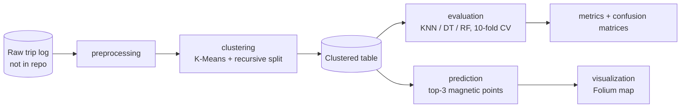
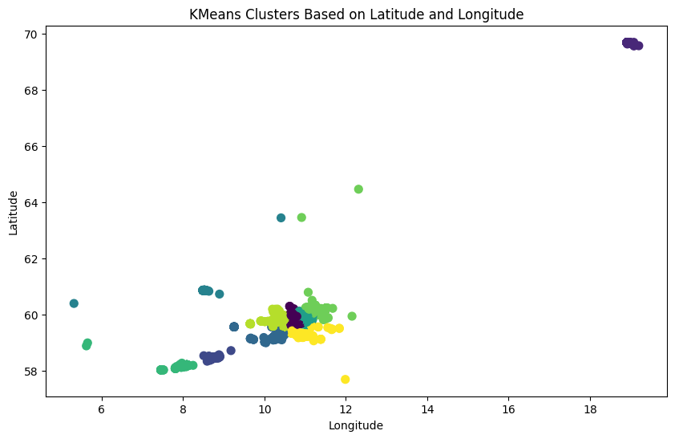
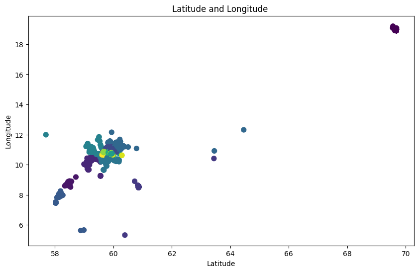
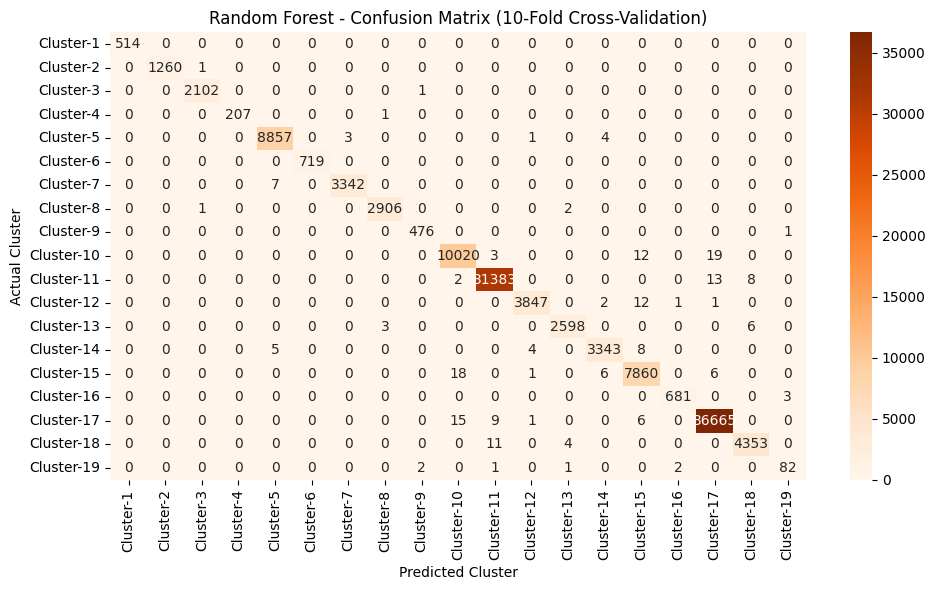
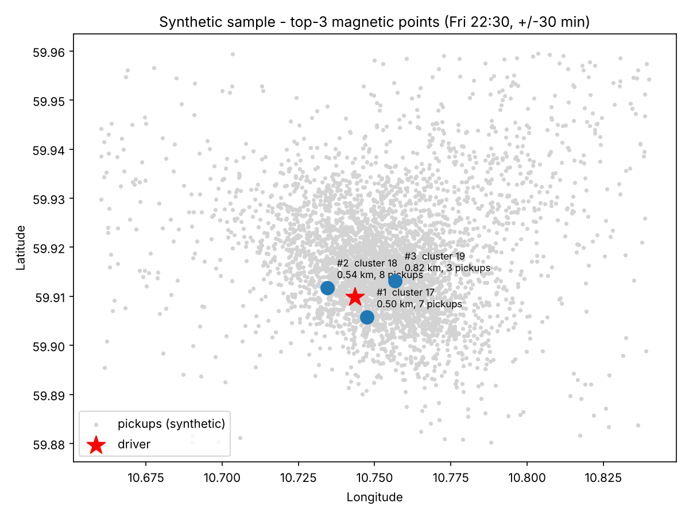

# Magnetic Points — Taxi Pickup Hotspot Recommendation with Recursive K-Means

Code, documentation and reproducibility material for the research paper:

> **Integrating AI in Ride-Hailing: A Framework for Taxi Hotspot Recommendation Using Recursive K-Means Clustering and Classification**
> Uzair Rasheed, Sadia Khalid, Muhammad Javaid, Danyal Khan, Umar Aslam, Khawaja Bilal Ahmad
>
> 📄 **Read the paper (IEEE Xplore): <https://ieeexplore.ieee.org/document/11591654>**
> 📎 [ResearchGate PDF](research/README.md#paper) (author-supplied link; may require sign-in)

<!-- TODO (maintainer): add venue, year, pages and DOI once confirmed from the IEEE Xplore page. They are not in the camera-ready PDF and were deliberately not guessed. -->

> **Status of this repository.** The proprietary dataset is *not* included, so none of the paper's numeric results were re-run here. The pipeline, tests and demos were executed on a **synthetic** sample (30 tests pass on Python 3.12.3). Where the paper, the authors' research document and the code disagree, see [docs/DISCREPANCIES.md](docs/DISCREPANCIES.md) — please read it before citing numbers from this repo.

---

## Table of contents

1. [Project overview](#1-project-overview) · 2. [Background](#2-research-background-and-problem-statement) · 3. [Paper reference](#3-research-paper-reference) · 4. [Objectives](#4-objectives) · 5. [Key features](#5-key-features) · 6. [Contributions](#6-research-contributions) · 7. [Tech stack](#7-technology-stack) · 8–9. [Dataset](#8-dataset-description) · 10. [Architecture](#10-system-architecture) · 11. [Methodology](#11-methodology-step-by-step) · 12–17. [Pipeline stages](#12-data-preprocessing) · 18. [Prediction](#18-prediction-system) · 19. [Visualization](#19-geographical-visualization) · 20. [Repository structure](#20-repository-structure) · 21–23. [Install and run](#21-installation) · 24. [Examples](#24-input-and-output-examples) · 25. [Expected results](#25-expected-results) · 26. [Reproducing](#26-reproducing-the-research-experiments) · 27. [Limitations](#27-limitations-and-future-improvements) · 28. [Contributing](#28-contributing) · 29. [License](#29-license) · 30. [Citation](#30-citation) · 31. [Acknowledgements](#31-acknowledgements)

---

## 1. Project overview

Ride-hailing platforms hold large amounts of spatio-temporal pickup data, but drivers rarely see it. This project turns historical taxi pickup logs into a **recommendation of the three nearest pickup hotspots ("magnetic points")** for a driver who supplies a position, a weekday and a time.

It does so in four steps, all implemented in [`src/magnetic_points/`](src/magnetic_points):

1. **Preprocess** raw logs: keep pickups, extract hour / minute / weekday.
2. **Cluster** pickups with K-Means, then **recursively re-cluster the largest cluster** to fix density imbalance (→ 19 spatial clusters), and label every pickup with its weekday (→ 19 × 7 = 133 cluster-day segments).
3. **Evaluate** the clustering by checking that KNN, Decision Tree and Random Forest can learn it (stratified 10-fold CV).
4. **Recommend** the nearest cluster-day centroids with a pickup count for the requested time window, and **visualise** them on an interactive Folium map.

## 2. Research background and problem statement

Drivers unfamiliar with local demand lose time and income cruising for passengers. Pickups in a city are very unevenly distributed: in the paper's data one plain K-Means cluster held **101,017 of 121,422** pickups. Density-based methods such as DBSCAN were reported by the authors to produce either one dominant cluster or fail to separate dense hotspots, so they developed a two-stage K-Means strategy and validated it with supervised classifiers. Details: [docs/METHODOLOGY.md](docs/METHODOLOGY.md).

## 3. Research paper reference

| | |
|---|---|
| **Title** | Integrating AI in Ride-Hailing: A Framework for Taxi Hotspot Recommendation Using Recursive K-Means Clustering and Classification |
| **Authors** | Uzair Rasheed, Sadia Khalid (NUST, College of Electrical and Mechanical Engineering); Muhammad Javaid, Danyal Khan, Umar Aslam, Khawaja Bilal Ahmad (Riphah International University) |
| **IEEE Xplore** | <https://ieeexplore.ieee.org/document/11591654> |
| **Venue / year / DOI** | *TODO — not verifiable from the supplied files; see [research/README.md](research/README.md)* |

Authors, title and affiliations were read from the camera-ready PDF. Published claims in this README are attributed to the paper; implementation statements are based on the code.

## 4. Objectives

* Provide drivers with actionable, time-aware pickup recommendations from historical data.
* Handle highly uneven pickup density without density-based clustering.
* Show that the resulting clusters are learnable by standard classifiers.
* Provide a documented, tested, reproducible implementation others can extend.

## 5. Key features

Implemented in this repository:

* Config-driven preprocessing → clustering → evaluation → prediction → visualization pipeline (`python -m magnetic_points …`).
* Recursive K-Means (auto-detects the largest cluster) and day-wise segment labels.
* Stratified 10-fold CV of KNN, Decision Tree and Random Forest with confusion matrices.
* `MagneticPointPredictor`: top-N nearest hotspots by haversine distance + pickup counts in a ± window; output verified equal to the original notebook function.
* Folium recommendation map and cluster overview map.
* Synthetic data generator so everything runs without the proprietary dataset.
* 30 automated tests.

**Not implemented** (stated in the paper or proposed, but absent from the provided code): a *deployed/trained* KNN predictor, a driver-facing app or real-time service, scalability benchmarks on large fleets, non-clustering alternatives (listed by the paper as future work).

## 6. Research contributions

As stated by the paper: the design and validation of an AI-enabled spatial decision framework combining unsupervised learning (a custom two-stage hierarchical K-Means), supervised validation (KNN / Decision Tree / Random Forest) and a time-aware recommendation service producing three suggested pickup locations. This repository contributes an executable, documented implementation of that workflow and a record of where paper and code differ.

## 7. Technology stack

Python · pandas · NumPy · scikit-learn (K-Means, KNN, Decision Tree, Random Forest, metrics, StratifiedKFold) · matplotlib · seaborn · Folium (Leaflet maps) · PyYAML · pytest · (tests only) haversine. Original experiments were run in Google Colab notebooks.

## 8. Dataset description

Real-world taxi vehicle-tracking logs collected for about a year by **AbsoluIT** (Norway); 242,509 log rows in the notebook (the paper says 242,508), of which 121,422 are pickups. **The data is not redistributed** — see [docs/DATASET.md](docs/DATASET.md) for the access note. A synthetic stand-in with the same schema ships in [`data/sample/`](data/sample).

## 9. Dataset attributes

| Attribute | Type | Meaning |
|---|---|---|
| `TourId` | int | trip identifier (dropped) — the paper's text sometimes calls it `VehId` |
| `VehLat` | float | latitude of the vehicle at log time |
| `VehLng` | float | longitude of the vehicle at log time |
| `Status` | int | 6 = pickup, 8 = drop-off |
| `CreatedDate` | datetime | `YYYY-MM-DD HH:MM` |

After preprocessing: `VehLat, VehLng, Hour (0–23), Minutes (0–59), DayOfWeek (0 = Monday … 6 = Sunday)`; after clustering: plus `Cluster` and `SubCluster`.

## 10. System architecture



More diagrams (workflow, preprocessing, hierarchical clustering, evaluation, prediction sequence): [docs/ARCHITECTURE.md](docs/ARCHITECTURE.md).

## 11. Methodology step by step

1. Keep pickup rows (`Status == 6`).
2. Extract `Hour`, `Minutes`, `DayOfWeek`; drop `TourId`, `Status`, `CreatedDate`.
3. K-Means, k = 10, on (`VehLat`, `VehLng`).
4. Re-cluster the largest cluster with K-Means, k = 10; relabel `+10`. Result: 19 clusters.
5. `SubCluster = DayOfWeek` → 133 segments.
6. Evaluate KNN (k = 3), Decision Tree, Random Forest (100 trees) with stratified 10-fold CV on (`VehLat`, `VehLng`) → `Cluster`.
7. For a driver query: nearest 3 cluster-day centroids (haversine) + pickups within ± window minutes.
8. Draw the result on a Folium map.

Each concept is explained (what / why / how / implementation / output / next stage) in [docs/METHODOLOGY.md](docs/METHODOLOGY.md).

## 12. Data preprocessing

`preprocessing.preprocess` loads the raw CSV, keeps `Status == 6`, derives the time features and returns five columns. On the paper's data this reduced 242,509 rows to 121,422 (notebook output). *Fixes relative to the uploaded notebook (`Minutes` bug, `TourId` retained) are listed in [DISCREPANCIES A1–A2](docs/DISCREPANCIES.md).*

## 13. Feature engineering

Only three derived features: hour of day, minute of hour, weekday. They are not used by K-Means; weekday defines the segments and hour/minute define the prediction time window.

## 14. K-Means clustering and recursive sub-clustering

K-Means (k = 10, `random_state = 42`) is run on raw latitude/longitude. The most populated cluster is re-clustered (k = 10) and its labels are shifted by +10, so 9 initial clusters survive and 10 new ones are added: **19 clusters**.

| Initial cluster sizes (paper's data, notebook output) | |
|---|---|
| 0: **101,017** · 5: 8,865 · 7: 3,349 · 8: 2,909 · 3: 2,103 · 2: 1,261 · 6: 719 · 1: 514 · 9: 477 · 4: 208 | cluster 0 is split |

<p align="center">


</p>

*Left: initial 10 clusters; right: final 19 clusters, exported from the authors' notebook. The right plot has latitude on the x-axis (notebook behaviour; this repo's plotting functions use longitude on x).*

## 15. Day-wise sub-clustering

`SubCluster` is simply `DayOfWeek`; no clustering is run in this step. Cluster × weekday gives 19 × 7 = 133 segments. (The paper calls these "sub-clusters"; [DISCREPANCIES B6](docs/DISCREPANCIES.md).)

## 16. Supervised machine learning models

| Model | Settings |
|---|---|
| K-Nearest Neighbors | `n_neighbors = 3` |
| Decision Tree | `random_state = 42` |
| Random Forest | `n_estimators = 100`, `random_state = 42` |

Features: `VehLat`, `VehLng`. Label: `Cluster`. (The paper lists `Cluster` among the *features*; the code uses it as the label.) The labels were generated from the same coordinates, so these models test **learnability of the partition**, not demand forecasting.

## 17. Model evaluation and performance results

Stratified 10-fold cross-validation, weighted precision/recall/F1. Values below are as published in the paper and **match the saved outputs of the authors' notebook**; they were not re-run here.

| Classifier | Accuracy | Precision | Recall | F1 |
|---|---|---|---|---|
| K-NN | 0.9979 | 0.9979 | 0.9979 | 0.9979 |
| Decision Tree | 0.9975 | 0.9975 | 0.9975 | 0.9975 |
| Random Forest | **0.9983** | **0.9983** | **0.9983** | **0.9983** |

Clustering quality reported by the paper — **no code for these exists in the uploaded notebooks** (see [DISCREPANCIES B7](docs/DISCREPANCIES.md)); use `python -m magnetic_points cluster-metrics` to compute them yourself:

| Metric | Paper |
|---|---|
| Silhouette | 0.736 |
| Davies–Bouldin | 0.320 |
| Calinski–Harabasz | 2,556,892 |

<p align="center">

</p>

## 18. Prediction system

```python
from magnetic_points.prediction import MagneticPointPredictor
predictor = MagneticPointPredictor(clustered_df)
predictor.predict(latitude=59.909851, longitude=10.743474, hour=14, minute=30, day_of_week=1)
```

Steps: filter to the weekday → centroid of each (cluster, weekday) group → haversine distance → 3 nearest → count pickups with time of day within ± 10 min of the request. The paper reports 0.4733 s for this step on Colab (a runtime, not a complexity class). Important behaviours: **the requested time changes only the pickup counts, not which points are returned**, and **no trained KNN is involved** (DISCREPANCIES B4–B5). The time window does not wrap past midnight.

## 19. Geographical visualization

`create_recommendation_map` produces an interactive Folium map (red = driver, blue = recommended points with popups: cluster, day, distance, pickups in window). Static preview and the interactive HTML generated from **synthetic** data:

<p align="center"></p>

[Open the interactive sample map](docs/figures/sample/sample_recommendation_map.html) (download and open locally; needs internet for map tiles).

## 20. Repository structure

```text
taxi-magnetic-points/
├── README.md  LICENSE  CITATION.cff  CHANGELOG.md  CONTRIBUTING.md  CODE_OF_CONDUCT.md
├── pyproject.toml  requirements.txt  requirements-dev.txt  .gitignore
├── configs/default.yaml            # every tunable parameter
├── src/magnetic_points/            # preprocessing, clustering, evaluation, prediction,
│                                   # visualization, synthetic, config, cli
├── scripts/make_doc_figures.py     # regenerates docs/figures/sample
├── tests/                          # 30 tests (incl. equivalence with notebook logic)
├── notebooks/original/             # the authors' two notebooks, unmodified
├── data/{raw,processed,sample}/    # raw/processed are git-ignored; sample is synthetic
├── models/                         # empty on purpose (no model is persisted)
├── outputs/                        # generated plots, metrics, maps (git-ignored)
├── research/README.md              # paper links and notes
└── docs/                           # ARCHITECTURE, METHODOLOGY, CODE_REFERENCE,
                                    # DEVELOPER_GUIDE, DATASET, REPRODUCIBILITY,
                                    # DISCREPANCIES, figures/
```

## 21. Installation

Requires Python ≥ 3.10 declared; **only Python 3.12.3 has been tested** ([versions](docs/REPRODUCIBILITY.md#tested-environment)).

```bash
git clone https://github.com/<your-username>/<repo-name>.git
cd <repo-name>
python -m venv .venv
source .venv/bin/activate            # Windows: .venv\Scripts\activate
pip install -r requirements-dev.txt
pip install -e .
python -m pytest                     # optional sanity check
```

## 22. Environment setup

* **Real data:** place the authorized file at `data/raw/TripLog.csv`.
* **No data:** `python -m magnetic_points make-sample` writes a synthetic file to `data/sample/TripLog_sample.csv`.
* Parameters live in [`configs/default.yaml`](configs/default.yaml); override with `--config my.yaml`.

## 23. How to run the project

```bash
# everything, on the synthetic sample
python -m magnetic_points run-all --raw data/sample/TripLog_sample.csv

# stage by stage
python -m magnetic_points preprocess --input data/raw/TripLog.csv
python -m magnetic_points cluster
python -m magnetic_points evaluate            # add --models K-NN to skip slower models
python -m magnetic_points cluster-metrics
python -m magnetic_points plots
python -m magnetic_points predict --lat 59.909851 --lng 10.743474 --hour 14 --minute 30 --day 1
```

`--day` is 0 = Monday … 6 = Sunday. Outputs go to `outputs/`. Troubleshooting: [docs/REPRODUCIBILITY.md](docs/REPRODUCIBILITY.md#troubleshooting). Developer how-tos (change k, swap classifiers, new dataset, extend maps): [docs/DEVELOPER_GUIDE.md](docs/DEVELOPER_GUIDE.md).

## 24. Input and output examples

Input (synthetic raw rows) → see [docs/DATASET.md](docs/DATASET.md). Prediction, synthetic sample, Friday 22:30, window ±30 min (executed):

```text
$ python -m magnetic_points predict --lat 59.909851 --lng 10.743474 --hour 22 --minute 30 --day 4 --time-window 30
Driver at (59.909851, 10.743474) on Friday 22:30
 Cluster  SubCluster  VehLat  VehLng  Distance_km  Pickups_in_window
      17           4 59.9058 10.7475       0.5027                  7
      18           4 59.9118 10.7345       0.5438                  8
      19           4 59.9132 10.7567       0.8240                  3
```

For comparison, the paper's Fig. 10 shows (real data) pickups of 40 / 24 / 12 at 0.26 / 3.04 / 6.45 km; that example's inputs are not recorded in the notebook, so it is not reproducible from the provided files.

## 25. Expected results

* **Real data** (from the notebook's saved output): 121,422 pickups; 19 clusters with sizes from 88 to 36,696; CV accuracies 0.9979 / 0.9975 / 0.9983. Full table: [docs/REPRODUCIBILITY.md](docs/REPRODUCIBILITY.md#reproducing-the-papers-experiments-authorized-users).
* **Synthetic sample** (executed): 5,196 pickups, 19 clusters, CV accuracy 0.9736 / 0.9754 / 0.9821 (KNN / DT / RF). These numbers say nothing about the paper.

## 26. Reproducing the research experiments

Follow [docs/REPRODUCIBILITY.md](docs/REPRODUCIBILITY.md). Key caveats: the data is proprietary; cluster label numbering can change with the scikit-learn version (set `clustering.n_init`); the clustering-quality metrics and the prediction example in the paper have no accompanying code/inputs.

## 27. Limitations and future improvements

**Limitations (current code)**
* Labels come from K-Means on the same features the classifiers use, so ~99.8 % accuracy shows learnability, not predictive value.
* Recommendations use per-weekday centroids: time of day does not influence which locations are returned, and a centroid of a large cluster may not be a real pickup spot.
* Euclidean K-Means on raw degrees; far-away points form their own clusters.
* No evaluation of recommendation quality against future pickups or driver outcomes.
* Single level of recursion; fixed k.

**Possible improvements (proposed, not implemented)**
* Time-aware centroids (per hour or window), held-out temporal validation, data scaling/projection, choosing k with elbow/silhouette, density-based or non-clustering methods (the paper's own future-work direction), a persisted model and service wrapper.

## 28. Contributing

Issues and pull requests are welcome — see [CONTRIBUTING.md](CONTRIBUTING.md) and the [Code of Conduct](CODE_OF_CONDUCT.md). Please run `python -m pytest` first; behaviour changes must update [docs/DISCREPANCIES.md](docs/DISCREPANCIES.md) and [CHANGELOG.md](CHANGELOG.md).

## 29. License

Code: [MIT](LICENSE). The paper is subject to its publisher's terms and the AbsoluIT dataset to its owner's terms; neither is relicensed by this repository. *(Licence chosen as a default — maintainers should confirm.)*

## 30. Citation

See [CITATION.cff](CITATION.cff) (GitHub shows a "Cite this repository" button). Until venue, year and DOI are confirmed:

```bibtex
@misc{rasheed_integrating_ai_ride_hailing,
  title        = {Integrating {AI} in Ride-Hailing: A Framework for Taxi Hotspot Recommendation Using Recursive K-Means Clustering and Classification},
  author       = {Rasheed, Uzair and Khalid, Sadia and Javaid, Muhammad and Khan, Danyal and Aslam, Umar and Ahmad, Khawaja Bilal},
  howpublished = {IEEE Xplore},
  url          = {https://ieeexplore.ieee.org/document/11591654},
  note         = {Venue, year and DOI: TODO}
}
```

## 31. Acknowledgements

The authors thank **AbsoluIT** (https://absoluit.com) for providing the dataset. The software builds on scikit-learn, pandas, NumPy, matplotlib, seaborn and Folium.
