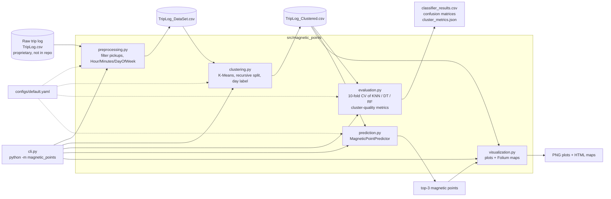
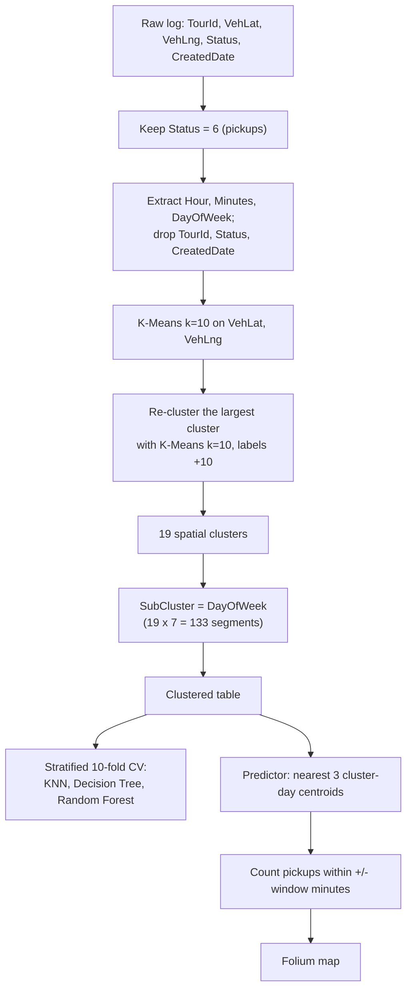
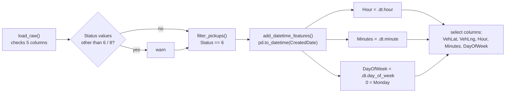
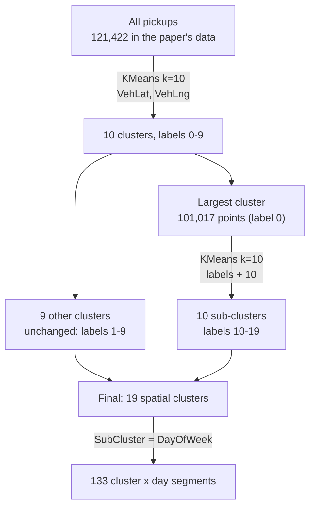
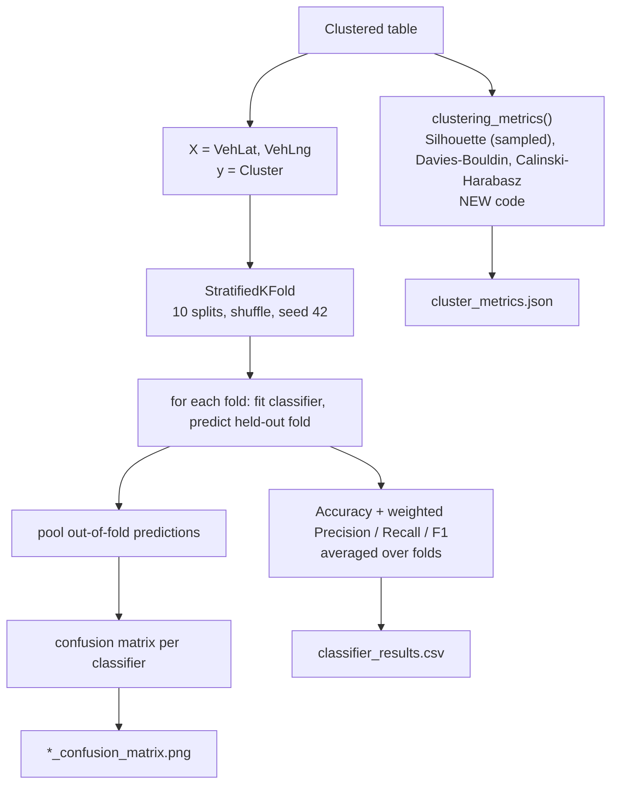
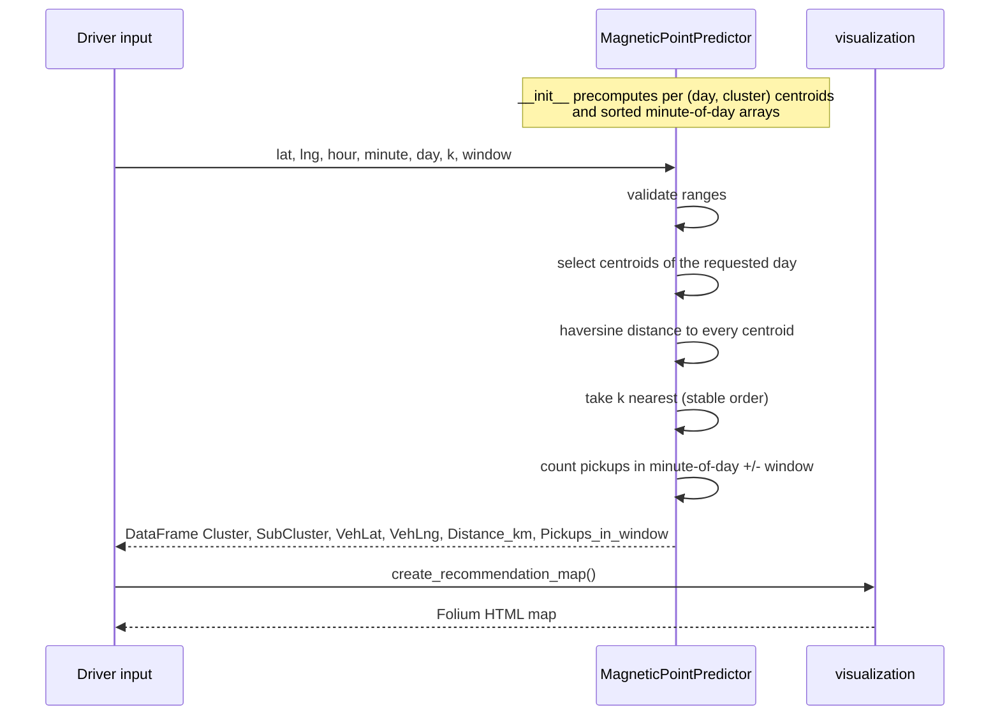

# Architecture and workflow diagrams

All diagrams are Mermaid (rendered natively by GitHub) and reflect the code in
`src/magnetic_points/`, not an idealised design.

## 1. System architecture

## 2. End-to-end workflow

## 3. Data preprocessing workflow

## 4. Hierarchical (recursive) clustering

The split cluster is the *largest* one; on the paper's data that was label 0.
On other data it can be a different label (see `clustering.split_cluster`).

## 5. Model training and evaluation workflow

## 6. Prediction pipeline

The requested time only affects the pickup counts; it does not change which three
locations are chosen (see `docs/DISCREPANCIES.md` B5).
